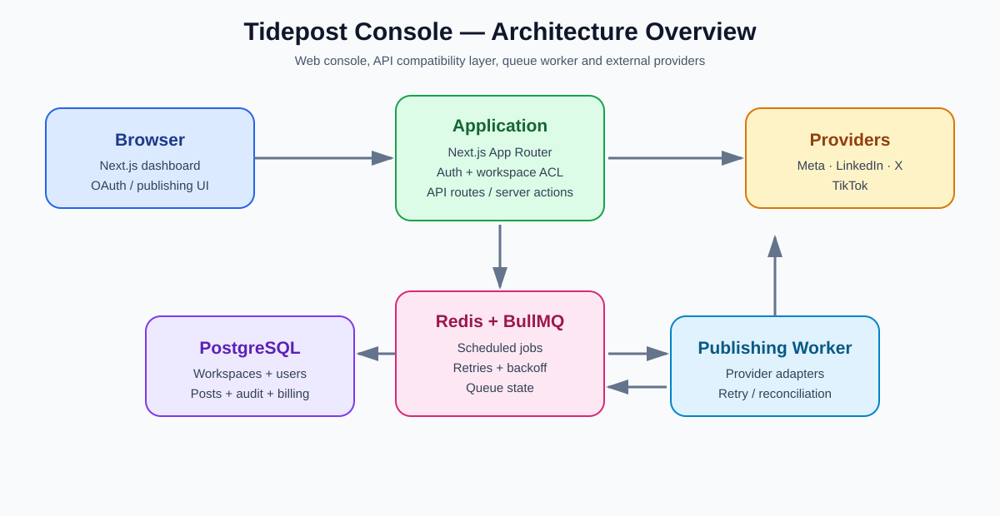
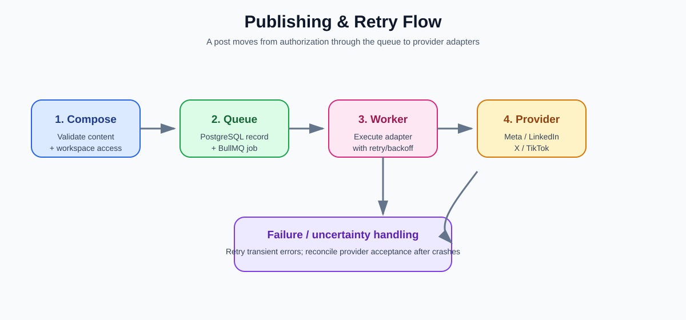
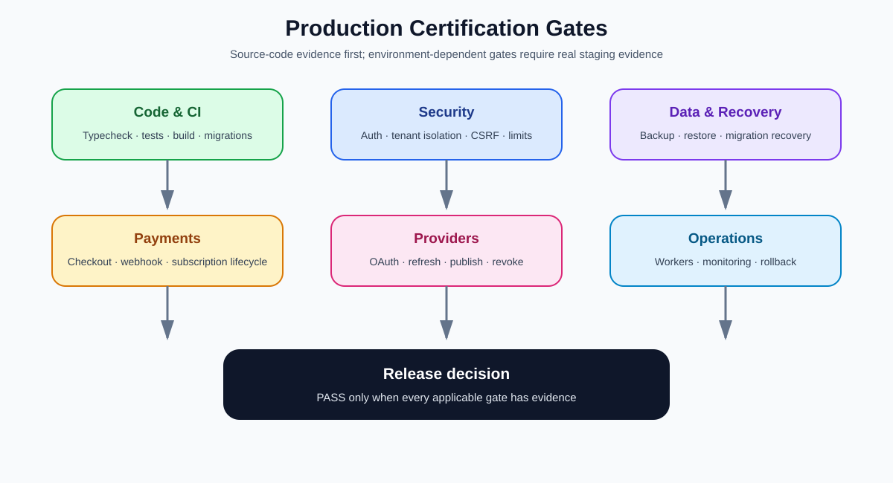

# Tidepost Console

Tidepost is a multi-workspace social-media management console built with Next.js App Router, TypeScript, PostgreSQL, Redis and BullMQ. The web application and scheduled publishing worker run as separate processes. The legacy Express API remains available for migration compatibility.

> **Release status:** Not yet verified as production-ready. The core app and provider adapters are implemented, but live provider flows require authorized developer apps and test accounts. LinkedIn analytics is not implemented, and provider-side exactly-once publishing cannot be guaranteed where idempotency is unavailable. See the [Production Certification](docs/PRODUCTION_CERTIFICATION.md) and [Production Readiness Runbook](docs/PRODUCTION_READINESS.md) for release gates.

## Visual tour

The diagrams in this section are **documentation visuals**, not captured screenshots. They describe the current intended architecture and workflows without pretending that unverified production screens exist.

### Product at a glance


### System architecture



The browser talks to the Next.js application. PostgreSQL stores users, workspaces, posts, audit and billing data. Redis/BullMQ handles scheduled work, and the separate publishing worker executes provider adapters.

### Publishing flow



Publishing is intentionally asynchronous: authorization and validation happen before queueing, the worker executes provider adapters, and transient failures are retried. A provider can accept a post immediately before a worker crash, so the application does not claim universal exactly-once delivery.

### Production certification



A green build is only one gate. Production approval requires evidence for security, tenant isolation, recovery, payments, provider integrations and operations. See [Production Certification](docs/PRODUCTION_CERTIFICATION.md).

### More visual guides

- [Visual Beginner's Guide](docs/BEGINNER_VISUAL_GUIDE.md) — step-by-step product concepts.
- [Architecture Overview](docs/images/architecture-overview.svg) — high-level system map.
- [Publishing Flow](docs/images/publishing-flow.svg) — queue, worker, provider and retry lifecycle.
- [Production Certification](docs/PRODUCTION_CERTIFICATION.md) — release gates and evidence requirements.
- [Agency SaaS Roadmap](docs/AGENCY_SAAS_ROADMAP.md) — intended subscription business model and staged rollout.

> **Screenshots and videos:** When a verified staging/demo recording is available, add it under `docs/media/` and link it from this section. Do not use fabricated screenshots or claim that an illustrative diagram is a live product capture.

## Android app

A native Kotlin + Jetpack Compose Android companion app lives in [`android-app/`](android-app/) with build instructions in the [Android App Guide](docs/ANDROID_APP.md). Current phone-to-web helpers include locally saved caption drafts, copy/share actions, a saved HTTPS console URL, and a shortcut to open the web console. Drafts are local to the phone and do **not** sync across devices yet. Live login, workspace data, scheduling, publishing, and analytics integration remain incomplete. GitHub Actions builds a test APK when Android app files change.

## Current audit status

The evidence-based audit is tracked in the [Full Production Readiness Audit](docs/AUDIT_REPORT.md). Targeted hardening includes cookie-authenticated billing settings protection, strict billing credential encryption validation, safe integer workspace identifiers, concurrent migration protection, and repeatable migration checks. The overall application remains **not production-ready** until the documented release gates pass.

## SaaS ownership and billing roadmap

Tidepost is intended to be a subscription platform for agencies, creators, celebrities, individuals and businesses. The current billing schema and payment rollout gates are documented in the [SaaS Billing Implementation Guide](docs/SAAS_BILLING_IMPLEMENTATION.md). **Payment checkout and subscription enforcement are not yet implemented; do not accept live payments until the release gates pass.**

## Payment credential settings foundation

The `feat/dashboard-managed-billing` branch adds API foundations for platform-owner and organization-scoped gateway settings, with AES-256-GCM encryption at rest. See [Dashboard-managed payment credentials](docs/BILLING_CREDENTIALS_DASHBOARD.md). These endpoints do not yet provide a finished dashboard UI or payment checkout; do not accept live payments until the complete payment lifecycle is implemented and tested.

## Requirements

- Node.js 22+
- PostgreSQL 14+
- Redis 6+
- npm
- HTTPS public URL in production
- OAuth apps and approved permissions for each provider you enable

## Local setup

1. Create a PostgreSQL database and a Redis instance.
2. Copy `.env.example` to `.env`.
3. Set at minimum:
   - `APP_URL`: app base URL; must exactly match the OAuth redirect URI registered with each provider.
   - `DATABASE_URL`: PostgreSQL connection string.
   - `REDIS_URL`: Redis connection string.
   - `JWT_SECRET`: random secret with at least 32 characters.
   - `SOCIAL_TOKEN_ENCRYPTION_KEY`: base64-encoded 32-byte key.
4. Generate the encryption key:
   ```bash
   openssl rand -base64 32
   ```
   Store it in your secret manager. **Do not lose or casually rotate this key**: existing social-account tokens cannot be decrypted without it.
5. Install dependencies and apply the idempotent initial schema:
   ```bash
   npm ci
   npm run db:migrate
   ```
6. Run the web app:
   ```bash
   npm run dev
   ```
7. Open `http://localhost:3000`, register, and sign in. Workspace owners/admins can start account linking from the Connected Accounts panel.
8. In another terminal, run the publishing worker:
   ```bash
   npm run worker:publish
   ```

The web process and worker must use the same PostgreSQL, Redis and token-encryption-key values. The legacy Express API uses `PORT` (default 3000); use another port if running it alongside Next.js.

## Commands

| Command | Purpose |
|---|---|
| `npm run dev` | Next.js development server |
| `npm run build` | Production build |
| `npm start` | Production Next.js server |
| `npm run typecheck` | TypeScript validation |
| `npm test` | Unit tests and opt-in PostgreSQL/Redis integration tests |
| `npm run db:migrate` | Apply the idempotent initial schema |
| `npm run worker:publish` | Scheduled publishing worker |
| `npm run start:legacy` | Optional legacy Express API |

Database changes are applied from ordered SQL files in `db/migrations/`. `npm run db:migrate` takes a PostgreSQL advisory lock, applies each migration transactionally, records its SHA-256 checksum, skips already-applied files, and refuses to run if an applied migration was edited. Add a new numbered migration for every schema change; do not edit an applied migration. The initial migration is designed to adopt existing schemas idempotently, but always back up production data and test restore/rollback procedures before deployment.

## OAuth and account linking

Configure provider credentials in the deployment secret manager and in local `.env` when testing. Never expose client secrets or provider tokens to browser code.

| Platform | Required environment variables | Notes |
|---|---|---|
| Facebook Pages | `META_APP_ID`, `META_APP_SECRET`, `META_GRAPH_API_VERSION` | The app needs Page listing/read and Page publishing permissions approved for the app/account. |
| Instagram | Same Meta variables | Requires an Instagram professional account linked to a Facebook Page and approved Instagram permissions. |
| LinkedIn | `LINKEDIN_CLIENT_ID`, `LINKEDIN_CLIENT_SECRET`, `LINKEDIN_API_VERSION` | App product access and member/organization scopes vary. Member posting is implemented; organization publishing needs a suitable organization identity and permissions. |
| X | `X_CLIENT_ID`, `X_CLIENT_SECRET` | OAuth 2.0 user context and write scopes are required. |
| TikTok | `TIKTOK_CLIENT_KEY`, `TIKTOK_CLIENT_SECRET` | The app must be approved for the required Login Kit/Content Posting API scopes. |

The callback URL is `{APP_URL}/api/social/callback`. Register that exact URL with each provider. The UI starts linking with a same-origin `POST` to `/api/social/{platform}/connect` containing `workspaceId`; the route verifies the `Origin` header and workspace owner/admin permission before redirecting to the provider.

OAuth state values are random, stored as hashes, expire after ten minutes, and are consumed once. X and TikTok authorization use PKCE. Provider tokens are encrypted with AES-256-GCM before persistence in `social_accounts.token_ciphertext`. Token refresh is attempted for providers that return a refresh token and have a configured refresh endpoint. Meta token lifecycle differs by app type and is not guessed: when a Meta token expires, reconnect the account using the approved Meta flow.

## Publishing and retry behavior

- Facebook: Page text posts via the Graph API.
- Instagram: image posts using the media-container then publish flow.
- LinkedIn: text posts via the Posts API, subject to API version and app permissions.
- X: text posts via API v2.
- TikTok: video posts using TikTok's URL-pull publishing flow.

BullMQ retries transient job failures with backoff. Successful platform attempts are recorded and skipped on subsequent retries. There is an unavoidable uncertainty window if a provider accepts a post but the worker crashes before persisting the provider response; not every provider offers an idempotency key, so exactly-once publishing cannot be guaranteed.

## Analytics ingestion

Actual metrics are stored in `post_analytics` and the dashboard shows reach only when synced values exist. The sync endpoint is `POST /api/cron/analytics` with a trusted `CRON_SECRET`. LinkedIn analytics ingestion is not implemented because the required access and object mapping are not yet verified. No synthetic reach is shown.

## Tests and verification

Run:

```bash
npm run typecheck
npm test
npm run build
```

GitHub Actions runs typecheck, tests, the production build, migration checks, and syntax/runtime-loader checks. CI does not have provider credentials and therefore cannot validate live OAuth, live publishing, provider permissions, rate limits, live analytics, or payment-provider behavior. Before launch, perform provider-specific smoke tests using accounts you own/control.

## Production deployment checklist

1. Deploy PostgreSQL with TLS, backups, restricted network access, and a tested restore procedure.
2. Deploy Redis with authentication/TLS where supported and persistence appropriate to your queue-recovery requirements.
3. Set application and provider secrets in the secret manager; never commit them.
4. Register the exact HTTPS OAuth callback URL with every provider.
5. Run `npm run db:migrate` as a controlled release step after taking a backup.
6. Build and run the web app with `npm run build && npm start`; run `npm run worker:publish` as a separate managed process.
7. Schedule authenticated analytics sync and monitor worker failures, provider rate limits, and token-expiry states.
8. Add persistent rate limiting, security headers, audit-log retention rules, alerting, backup/restore drills and rollback before production use.
9. Run authorized live OAuth/publish/revoke/refresh tests for each provider. Do not enable a platform solely because the TypeScript build passes.

## Troubleshooting

- **OAuth redirects with an error:** confirm provider credentials, exact `APP_URL`, app mode/approval, account role and scopes.
- **Facebook/Instagram shows no account:** link an Instagram professional account to a Facebook Page and grant the app access.
- **Account requires reconnect:** provider rejected an API call or credentials expired.
- **TikTok publish fails:** verify Content Posting API approval, scopes, video URL reachability and supported format.
- **Scheduled post stays queued:** verify PostgreSQL/Redis connectivity, ensure the worker is running, and inspect queue logs.
- **Reach shows a dash:** no supported metrics have been synced yet.
- **Token decryption fails:** ensure every web/worker instance uses the same encryption key.
