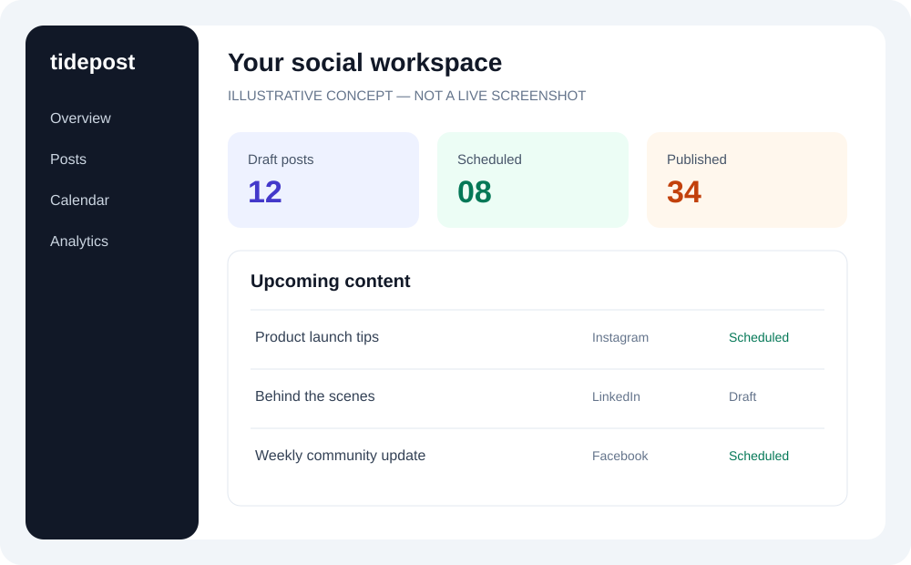
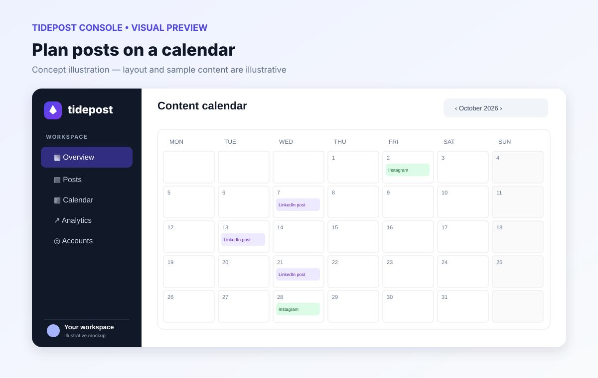
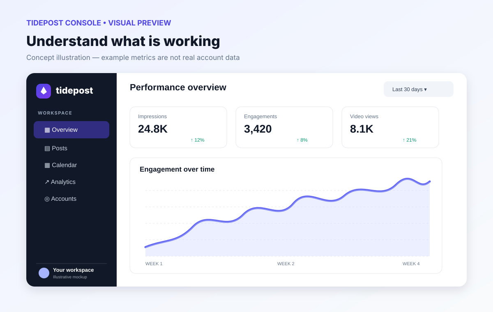
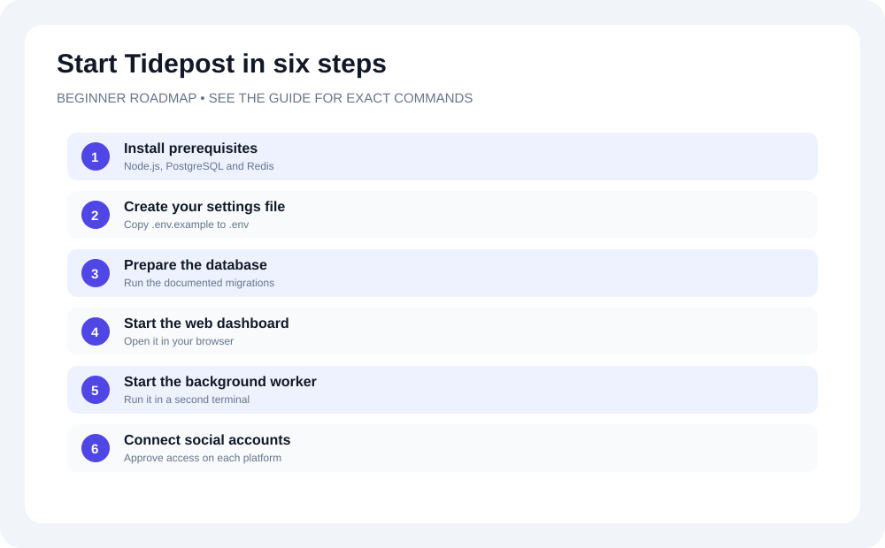

# Tidepost Console

Tidepost is a multi-workspace social-media management console built with Next.js App Router, TypeScript, PostgreSQL, Redis and BullMQ. The web application and scheduled publishing worker run as separate processes. The legacy Express API remains available for migration compatibility.

> **Release status:** Not yet verified as production-ready. The core app and provider adapters are implemented, but live provider flows require authorized developer apps and test accounts. LinkedIn analytics is not implemented, and provider-side exactly-once publishing cannot be guaranteed where idempotency is unavailable. See the [Production Readiness Runbook](docs/PRODUCTION_READINESS.md) for release gates.

## Visual tour

The images below are **illustrative UI concepts**, not screenshots captured from a running deployment. They help beginners understand the main ideas; actual screens and available data can vary by build and configuration.

| Dashboard overview | Planning calendar |
|---|---|
|  |  |

| Analytics overview | Beginner setup roadmap |
|---|---|
|  |  |

For the full step-by-step explanation, see the [Visual Beginner's Guide](docs/BEGINNER_VISUAL_GUIDE.md).

## Requirements

- Node.js 22+
- PostgreSQL 14+
- Redis 6+
- npm
- HTTPS public URL in production
- OAuth apps and approved permissions for each provider you enable

## Local setup

1. Create a PostgreSQL database and a Redis instance.
2. Copy `.env.example` to `.env`.
3. Set at minimum:

   - `APP_URL`: app base URL; must exactly match the OAuth redirect URI registered with each provider.
   - `DATABASE_URL`: PostgreSQL connection string.
   - `REDIS_URL`: Redis connection string.
   - `JWT_SECRET`: random secret with at least 32 characters.
   - `SOCIAL_TOKEN_ENCRYPTION_KEY`: base64-encoded 32-byte key.
4. Generate the encryption key:

   ```bash
   openssl rand -base64 32
   ```

   Store it in your secret manager. **Do not lose or casually rotate this key**: existing social-account tokens cannot be decrypted without it.
5. Install dependencies and apply the idempotent initial schema:

   ```bash
   npm install
   npm run db:migrate
   ```

6. Run the web app:

   ```bash
   npm run dev
   ```

7. Open `http://localhost:3000`, register, and sign in. Workspace owners/admins can start account linking from the Connected Accounts panel.
8. In another terminal, run the publishing worker:

   ```bash
   npm run worker:publish
   ```

The web process and worker must use the same PostgreSQL, Redis and token-encryption-key values. The legacy Express API uses `PORT` (default 3000); use another port if running it alongside Next.js.

## Commands

| Command | Purpose |
|---|---|
| `npm run dev` | Next.js development server |
| `npm run build` | Production build |
| `npm start` | Production Next.js server |
| `npm run typecheck` | TypeScript validation |
| `npm test` | Unit tests and opt-in PostgreSQL/Redis integration tests |
| `npm run db:migrate` | Apply the idempotent initial schema |
| `npm run worker:publish` | Scheduled publishing worker |
| `npm run start:legacy` | Optional legacy Express API |

The schema bootstrap is not yet a versioned migration framework. Back up production data before applying schema changes. For production, replace this with ordered, versioned migrations and a rollback plan.

## OAuth and account linking

Configure provider credentials in the deployment secret manager and in local `.env` when testing. Never expose client secrets or provider tokens to browser code.

| Platform | Required environment variables | Notes |
|---|---|---|
| Facebook Pages | `META_APP_ID`, `META_APP_SECRET`, `META_GRAPH_API_VERSION` | The app needs Page listing/read and Page publishing permissions approved for the app/account. |
| Instagram | Same Meta variables | Requires an Instagram professional account linked to a Facebook Page and approved Instagram permissions. |
| LinkedIn | `LINKEDIN_CLIENT_ID`, `LINKEDIN_CLIENT_SECRET`, `LINKEDIN_API_VERSION` | App product access and member/organization scopes vary. Member posting is implemented; organization publishing needs a suitable organization identity and permissions. |
| X | `X_CLIENT_ID`, `X_CLIENT_SECRET` | OAuth 2.0 user context and write scopes are required. |
| TikTok | `TIKTOK_CLIENT_KEY`, `TIKTOK_CLIENT_SECRET` | The app must be approved for the required Login Kit/Content Posting API scopes. |

The callback URL is `{APP_URL}/api/social/callback`. Register that exact URL with each provider. The UI starts linking with a same-origin `POST` to `/api/social/{platform}/connect` containing `workspaceId`; the route verifies the `Origin` header and workspace owner/admin permission before redirecting to the provider.

OAuth state values are random, stored as hashes, expire after ten minutes, and are consumed once. X and TikTok authorization use PKCE. Provider tokens are encrypted with AES-256-GCM before persistence in `social_accounts.token_ciphertext`. The ciphertext format is:

```text
v1:<base64-iv>:<base64-auth-tag>:<base64-ciphertext>
```

Token refresh is attempted for providers that return a refresh token and have a configured refresh endpoint (LinkedIn, X, TikTok). A rotated token is persisted before the publish request. Meta token lifecycle differs by app type and is not guessed: when a Meta token expires, reconnect the account using the approved Meta flow. Authorization failures mark the account as requiring reconnection. Disconnect disables local publishing and attempts provider revocation where supported; provider revocation is best-effort and must be confirmed in each provider's app/security settings when required.

## Publishing and retry behavior

- Facebook: Page text posts via the Graph API.
- Instagram: image posts using the media-container then publish flow. The image URL must be publicly accessible over HTTPS.
- LinkedIn: text posts via the Posts API, subject to API version and app permissions.
- X: text posts via API v2.
- TikTok: video posts using TikTok's URL-pull publishing flow. Provide a publicly accessible HTTPS **video** URL whose domain/URL prefix is verified as required in the TikTok developer app. The app must have approved Content Posting API access. Multipart upload, photo posts, and other TikTok formats are not implemented.

The composer uses one media URL field: an image for Instagram, a video for TikTok. Avoid selecting incompatible media platforms together. Provider API schemas and available scopes change; check each provider's current official documentation before enabling an account.

BullMQ retries transient job failures with backoff. Successful platform attempts are recorded and skipped on subsequent retries, so a platform already recorded as successful is not deliberately sent again. There is an unavoidable uncertainty window if a provider accepts a post but the worker crashes before persisting the provider response; not every provider offers an idempotency key, so exactly-once publishing cannot be guaranteed. Monitor failed attempts and reconcile uncertain publishes against the provider's account.

## Analytics ingestion

Actual metrics are stored in `post_analytics` and the dashboard shows reach only when synced values exist. The sync endpoint is:

```http
POST /api/cron/analytics
Authorization: Bearer <CRON_SECRET>
```

Set `CRON_SECRET` to a random secret of at least 32 characters, and call this endpoint from a trusted scheduler (for example, a secured cron job) on a sensible interval. Never call it from browser code or expose the secret to users. The endpoint reports counts of synced, skipped, and failed records.

- Facebook and Instagram: Graph API insights are requested using the configured Meta Graph API version. Available metrics depend on object type, permissions, and current API support.
- X: public engagement metrics are ingested; impressions are not claimed without the appropriate API access.
- TikTok: video view/like/comment/share metrics are queried where the connected account and scopes permit it.
- LinkedIn: analytics ingestion is not implemented because the required organization/member analytics access and object mapping are not yet verified. No synthetic reach is shown.

Provider APIs can rate-limit or remove metrics; the latest saved values are not a guarantee of real-time analytics.

## Tests and verification

Run:

```bash
npm run typecheck
npm test
npm run build
```

Unit tests cover JWT issuer/expiry/signature validation and AES-256-GCM token encryption, round-trip decryption, tamper rejection, and invalid keys. The integration tests are **skipped unless their environment variables are supplied**:

- Set `DATABASE_URL` to a disposable PostgreSQL database that has had `npm run db:migrate` applied to check schema and workspace-membership isolation.
- Set `REDIS_URL` to a test Redis instance to verify connectivity.
- Configure both to run the combined database/Redis availability check.

GitHub Actions runs typecheck, tests, the production build, and syntax/runtime-loader checks. CI does not have provider credentials and therefore cannot validate live OAuth, live publishing, provider permissions, rate limits, or live analytics. Before launch, perform provider-specific smoke tests using accounts you own/control, then inspect the resulting posts in each provider UI.

## Production deployment checklist

1. Deploy PostgreSQL with TLS, backups, restricted network access, and a tested restore procedure.
2. Deploy Redis with authentication/TLS where supported and persistence appropriate to your queue-recovery requirements.
3. Set `APP_URL`, `DATABASE_URL`, `DATABASE_SSL`, `REDIS_URL`, `JWT_SECRET`, `SOCIAL_TOKEN_ENCRYPTION_KEY`, `CRON_SECRET`, and provider secrets in the secret manager.
4. Register the exact HTTPS OAuth callback URL with every provider; request only scopes your app has been approved to use.
5. Run `npm run db:migrate` as a controlled release step after taking a backup.
6. Build and run the web app with `npm run build && npm start`; run `npm run worker:publish` as a separate managed process.
7. Schedule authenticated analytics sync and monitor its result codes, worker failures, provider rate limits, and token-expiry/reconnect states.
8. Add persistent rate limiting to registration/login/OAuth-start endpoints, security headers, audit-log retention rules, alerting, backup/restore drills, versioned migrations, and deployment rollback before production use.
9. Run authorized live OAuth/publish/revoke/refresh tests for each provider and review all requested app scopes and API versions. Do not enable a platform solely because the TypeScript build passes.

## Troubleshooting

- **OAuth redirects with an error:** confirm the provider client ID/secret, exact `APP_URL` callback URL, app mode/approval, account role, and requested scopes. Check server logs; user-facing callbacks intentionally avoid exposing secrets or provider error payloads.
- **Facebook/Instagram shows no account:** link an Instagram professional account to a Facebook Page, grant the app access to that Page, and ensure the selected account is visible to the authorizing user.
- **Account shows error / reconnect needed:** the provider rejected an API call or credentials expired. Use Connect again; for Meta, follow the provider's approved token lifecycle.
- **TikTok publish fails:** verify Content Posting API approval, `video.publish` scope, video URL reachability, verified URL/domain ownership, supported video format, and the app's privacy/visibility settings.
- **Scheduled post stays queued:** verify PostgreSQL and Redis connectivity, ensure `npm run worker:publish` is running, and inspect BullMQ worker logs plus `publish_attempts`.
- **Reach shows a dash:** no supported metrics have been synced yet. Configure `CRON_SECRET`, call the analytics endpoint from a trusted scheduler, and verify the provider has granted insights scopes.
- **Token decryption fails:** ensure every web/worker instance uses the same base64 32-byte `SOCIAL_TOKEN_ENCRYPTION_KEY`. Do not replace the key without a planned token rotation/re-encryption process.
