# Tidepost Console — Visual Beginner's Guide

> **Who this is for:** someone who wants to use or host Tidepost but is new to software development. You do not need to understand every technical word. Follow the steps in order and use the diagrams as maps.

## First: what is Tidepost?


> These pictures are explanatory mockups, not screenshots of a live running instance. Sample counts and post names are fictional; use the app itself to verify real features and data.

Tidepost is a dashboard for preparing social-media posts and sending them to connected social accounts. Think of it like a central desk: you write a post in one place, choose supported platforms, and Tidepost sends it using the permissions you granted.

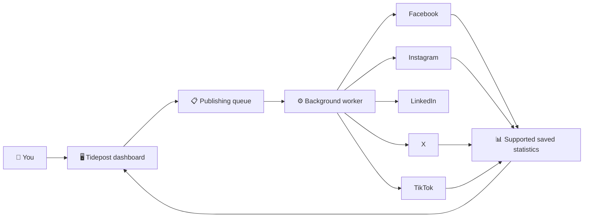

**In everyday language:** the dashboard is where you work, the queue is a to-do list, and the worker is a helper that carries out scheduled publishing tasks. Each social platform still controls its own permissions and API access.

## Before you begin: the checklist

| Item | What it means | Ready? |
|---|---|---|
| Node.js 22 or newer | Runs the web app | ☐ |
| PostgreSQL 14 or newer | Stores users, workspaces, posts and records | ☐ |
| Redis 6 or newer | Helps manage the publishing task queue | ☐ |
| Provider developer apps | Let Tidepost request permission to act on your social accounts | ☐ |
| A secure encryption key and app secrets | Protect credentials and sessions | ☐ |

For a first local test, install the software on your own computer. For a public production service, you also need a secure HTTPS address and a hosting setup.

## Step 1 — Understand the pieces

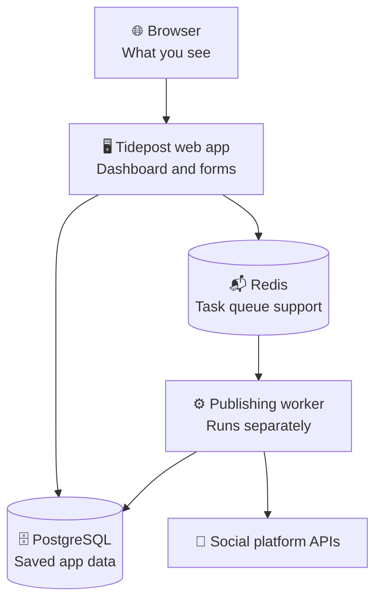

- **Browser:** your window into Tidepost.
- **Web app:** receives your clicks and displays pages.
- **PostgreSQL:** the organized filing cabinet for app data.
- **Redis:** helps keep track of jobs waiting to run.
- **Worker:** a separate process that sends publishing jobs.
- **Social platform API:** the official connection point provided by a platform.

The web app and worker must use the same database, Redis connection, and token-encryption key. If one of those settings differs, publishing or account access may fail.

## Step 2 — Prepare the settings file

The project includes an example settings file named `.env.example`. Make a copy called `.env` in the project folder and fill in the values for your own setup.

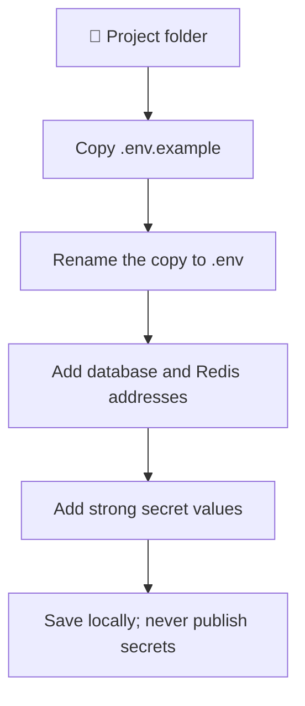

Minimum settings include:

- `APP_URL`: the address where Tidepost opens. OAuth callback URLs must match it exactly.
- `DATABASE_URL`: how Tidepost reaches PostgreSQL.
- `REDIS_URL`: how Tidepost reaches Redis.
- `JWT_SECRET`: a strong secret used for signed login sessions.
- `SOCIAL_TOKEN_ENCRYPTION_KEY`: a base64-encoded 32-byte key that protects stored social-account tokens.

Generate the encryption key with:

```bash
openssl rand -base64 32
```

**Important:** treat `.env` like a key to your house. Do not upload it to GitHub, paste it into public chats, or share it in screenshots. Keep the same encryption key for the web app and worker. Losing it can make previously stored social tokens unreadable.

## Step 3 — Install and start Tidepost locally


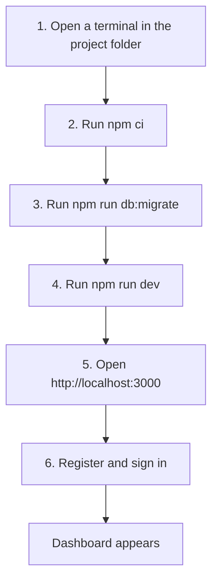

Run these commands one at a time:

```bash
npm ci
npm run db:migrate
npm run dev
```

Then open **http://localhost:3000** in your browser.

- `npm ci` downloads the project's required packages.
- `npm run db:migrate` prepares the database tables.
- `npm run dev` starts the website for local development.

Keep that terminal open while you use the app. To stop the development server, press `Ctrl+C` in that terminal.

## Step 4 — Start the publishing helper

Open a **second terminal** in the same project folder. Do not close the first terminal.

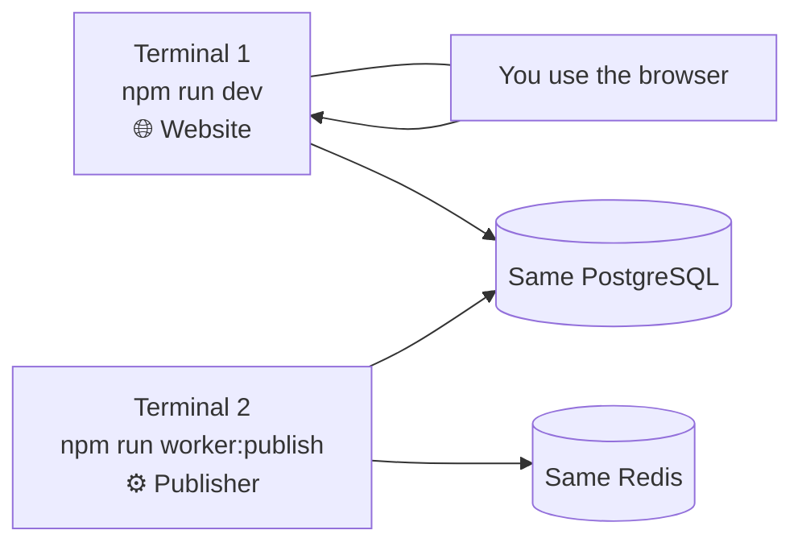

Run:

```bash
npm run worker:publish
```

The website and worker are two different jobs. The website shows the dashboard; the worker handles queued publishing work. A post may remain queued if the worker is not running or cannot connect to Redis/database.

## Step 5 — Connect a social account

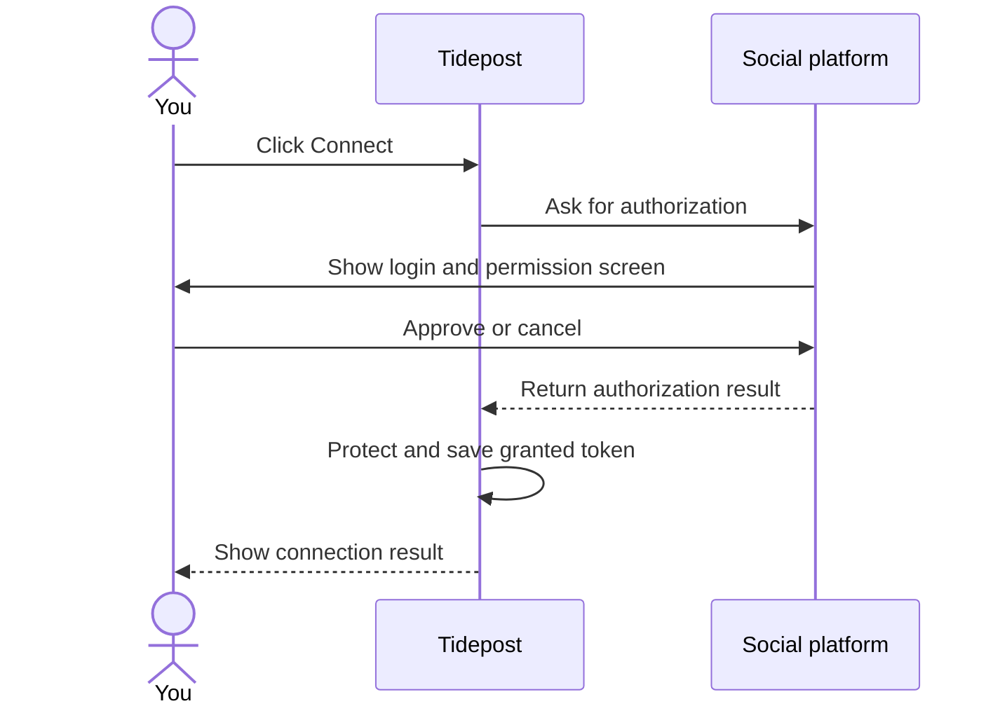

1. A workspace owner/admin starts connecting a supported account from **Connected Accounts**.
2. Tidepost sends you to the platform's own authorization page.
3. Read the requested permissions carefully and approve only if you trust the app.
4. The platform sends you back to Tidepost.
5. Tidepost encrypts the granted token before storing it.

**A successful build does not mean OAuth has been tested with your provider account.** You need your own correctly configured developer app, client credentials, approved permissions and an account you control. Provider review/approval may be required.

## Step 6 — Create and publish a post


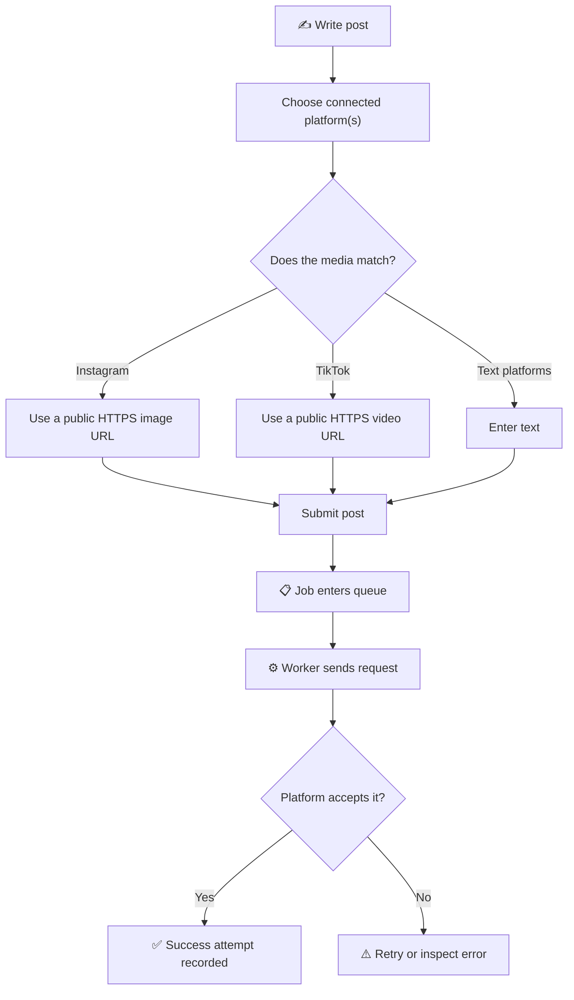

Begin with a test post to an account you own. Platform-specific rules matter:

- **Facebook:** Page publishing requires the correct Page and approved permissions.
- **Instagram:** this implementation expects a professional account connected to a Facebook Page and a publicly reachable HTTPS image URL.
- **LinkedIn:** text publishing is implemented, subject to app access and scopes.
- **X:** text publishing is implemented, subject to OAuth write access.
- **TikTok:** this implementation uses URL-pull video publishing; the video URL/domain must be publicly reachable and verified as required by TikTok. Approved API access and scopes are needed.

Do not select incompatible media types together. Review the published post in the actual platform to confirm the result.

### What happens when a post fails?

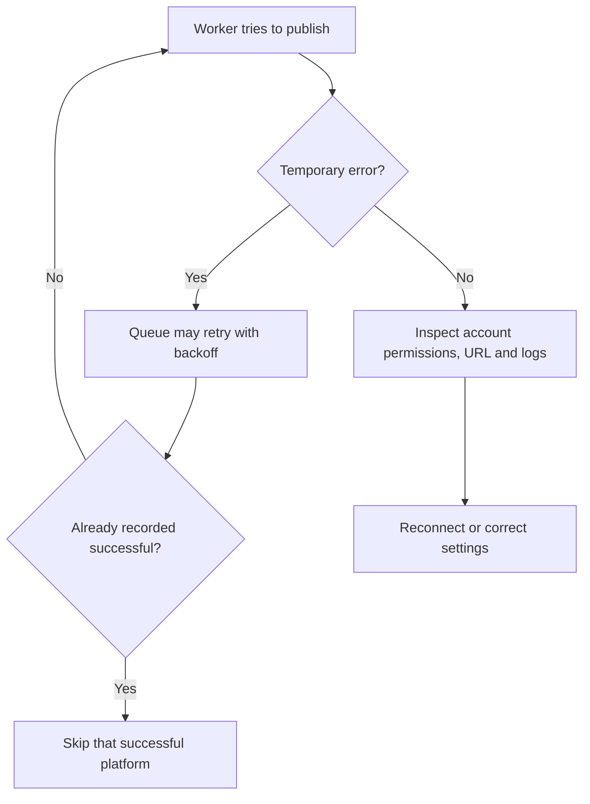

The queue retries certain failures and recorded successful platform attempts are skipped on later retries. However, some platforms do not support idempotency keys. If a platform accepts a post and the worker crashes before saving that success, a duplicate or uncertain result is still possible. Check the provider's own account before manually retrying uncertain posts.

## Step 7 — Understand analytics


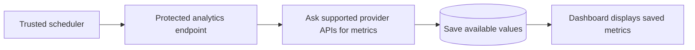

Analytics are not automatically real-time. A trusted scheduler must call `POST /api/cron/analytics` with the configured `CRON_SECRET` in an authorization header. Never place this secret in browser code.

- Facebook/Instagram: available insights depend on API version, account type and granted permissions.
- X: public engagement metrics are ingested; impressions are not claimed without suitable API access.
- TikTok: video metrics may be available for the connected account and granted scopes.
- LinkedIn: analytics ingestion is **not implemented**; Tidepost should not invent numbers.

A dash or empty metric usually means no supported values have been synced yet, or the provider does not grant access to that metric.

## Step 8 — Run the project checks

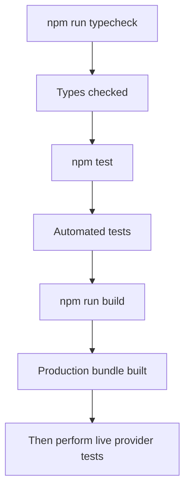

Run:

```bash
npm run typecheck
npm test
npm run build
```

These checks help catch code, test and build problems. They do **not** prove that your real provider credentials, permissions, publishing, refresh, revocation, rate limits or live analytics work. Integration tests also need the relevant test database/Redis settings.

## Step 9 — Before putting it on the internet

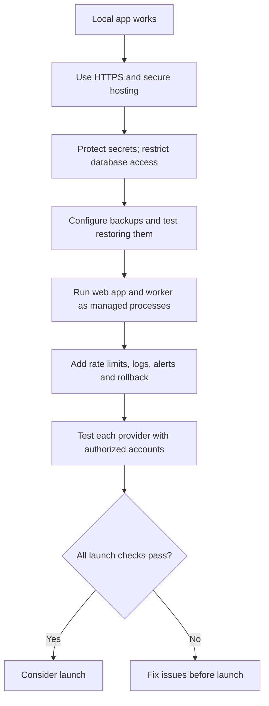

Before production, set up HTTPS, secure secret storage, restricted database access, backups with a tested restore, persistent rate limiting, security headers, logs/alerts, versioned database migrations and a rollback plan. Run the web process and worker as separate managed services. Verify every enabled provider with accounts you own or are authorized to manage.

## Quick troubleshooting map

| What you see | First thing to check |
|---|---|
| Website will not open | Is `npm run dev` still running? Is port 3000 free? |
| Database connection error | Is PostgreSQL running and is `DATABASE_URL` correct? |
| Queue stays waiting | Is the worker running? Can it reach Redis and PostgreSQL? |
| Connect button returns an error | Check provider credentials, exact callback URL, app approval and scopes. |
| Instagram account is missing | Is it a professional account linked to a Facebook Page accessible to the authorizing user? |
| TikTok publishing fails | Check API approval, scopes, video URL accessibility and domain verification. |
| Analytics are blank | Has the trusted analytics sync run? Does the provider grant that metric? |
| Token cannot be decrypted | Does every app/worker instance use the original same encryption key? |

## Words in plain English

- **API:** an official way for two software systems to communicate.
- **OAuth:** a permission process that lets you authorize an app without giving it your social-media password.
- **Token:** a credential that represents the permission granted to the app.
- **Encryption:** scrambling data so it cannot be read without the correct key.
- **Worker:** a background process that carries out queued jobs.
- **Queue:** a waiting list of jobs.
- **Migration:** a controlled change to the database structure.
- **HTTPS:** an encrypted connection between a browser and a website.

## Remember

Tidepost's code and automated checks are only part of the picture. Provider credentials, API approvals, live account tests and production hosting/security work are separate requirements. See the main [README](../README.md) for the complete environment-variable list and technical limitations.
